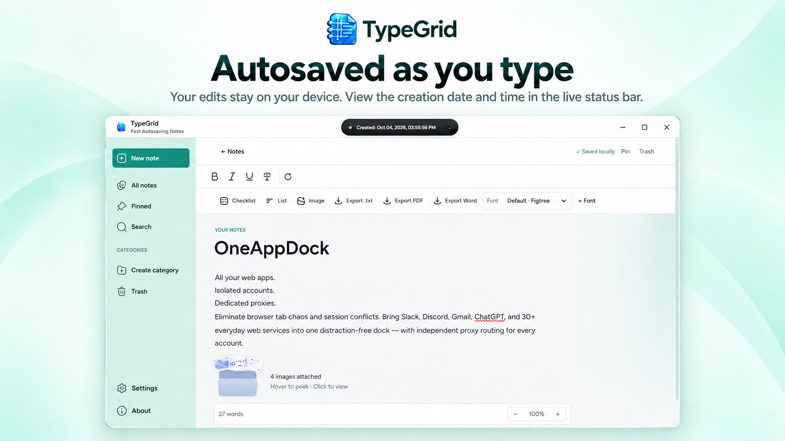
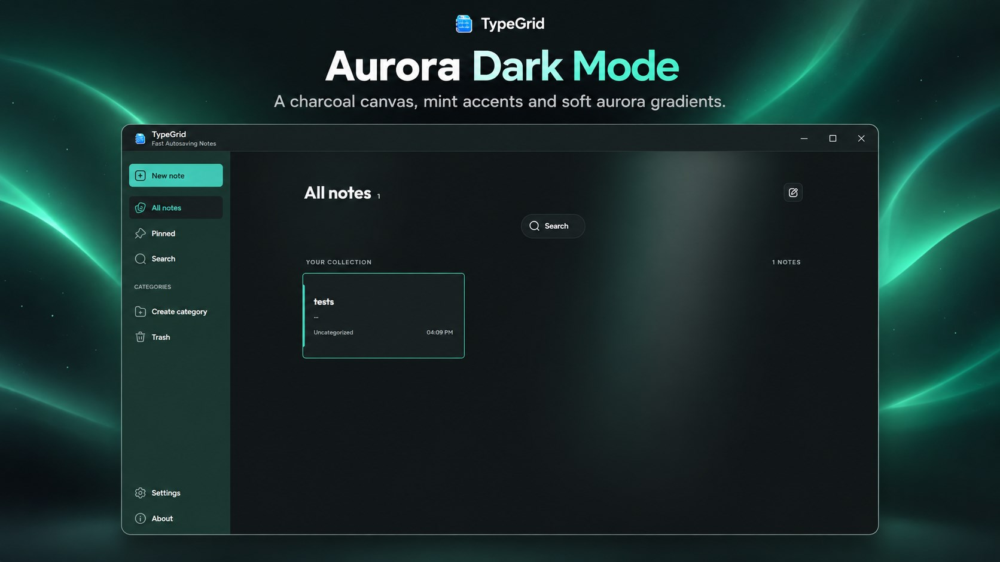
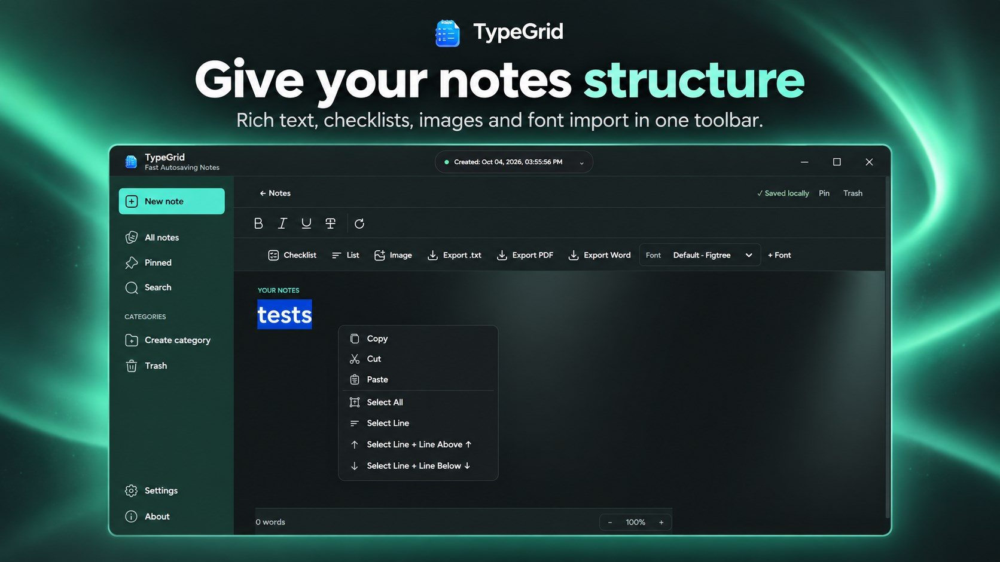
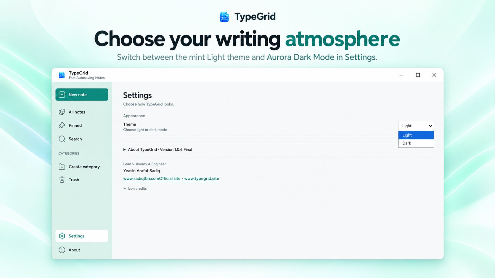
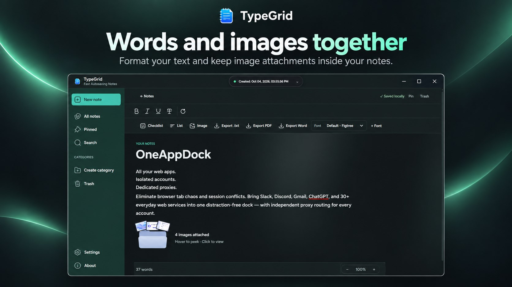
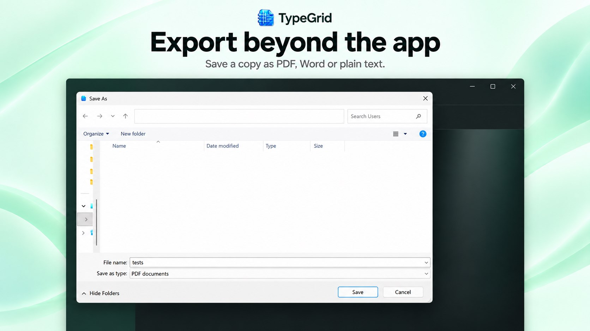
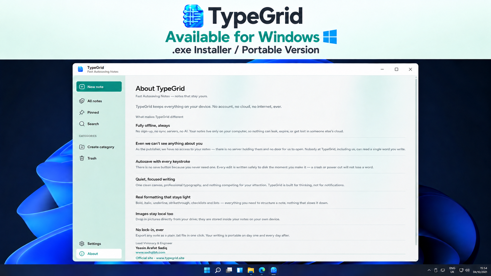
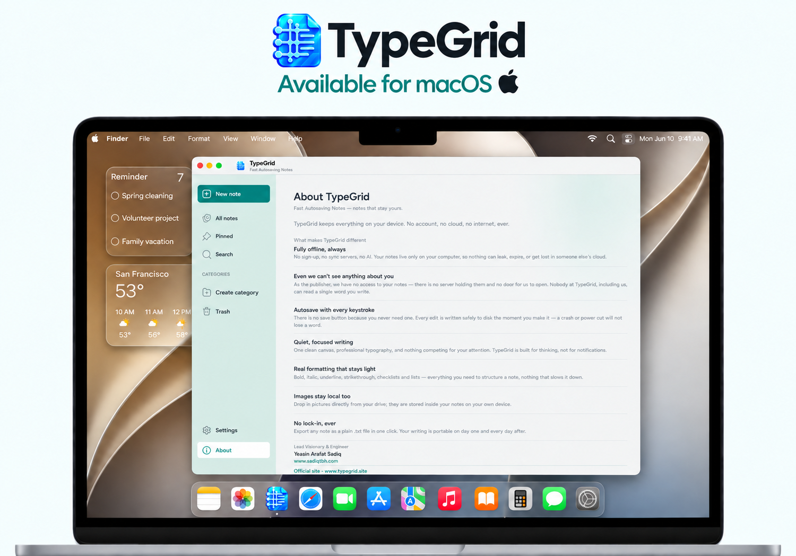
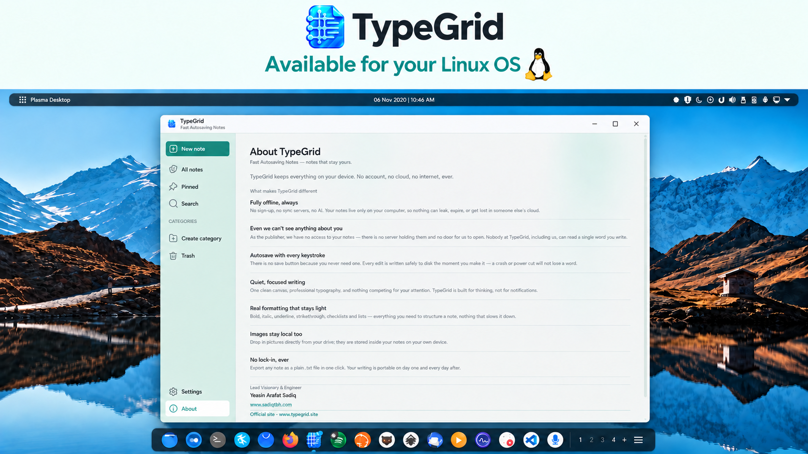
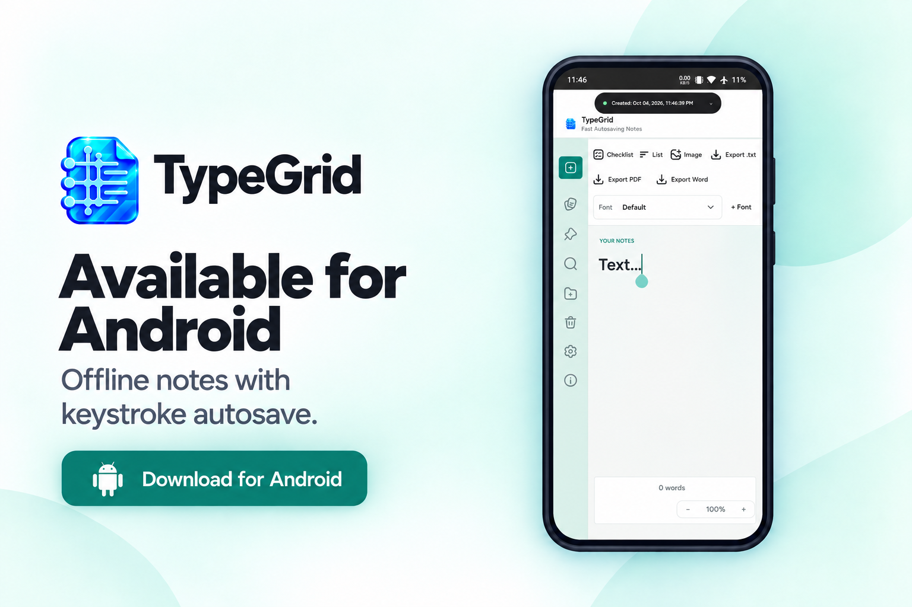

# TypeGrid

### Write Without Friction. Autosaved On Every Keystroke.
**Minimalist, ultra-fast, 100% offline note-taking app.**

 

### 🌐 Direct Downloads Available at: [**www.typegrid.site**](https://www.typegrid.site/) &nbsp;•&nbsp; [**typegrid.apk.com**](https://typegrid.apk.com/)

[**Windows MSI (.msi)**](https://github.com/sadiqtbh/TypeGrid/releases/download/v1.0.6/TypeGrid-1.0.6.msi) &nbsp;•&nbsp; [**Windows Portable (.exe)**](https://typegrid.site/api/public/downloads/TypeGrid-Portable-1.0.6.exe) &nbsp;•&nbsp; [**Microsoft Store**](https://apps.microsoft.com/detail/9p2304400d54?hl=en-US&gl=BZ) &nbsp;•&nbsp; [**macOS (Apple Silicon)**](https://typegrid.site/api/public/downloads/TypeGrid-macOS-AppleSilicon-1.0.6.zip) &nbsp;•&nbsp; [**macOS (Intel)**](https://typegrid.site/api/public/downloads/TypeGrid-macOS-Intel-1.0.6.zip) &nbsp;•&nbsp; [**Linux (.tar.gz)**](https://typegrid.site/api/public/downloads/TypeGrid-Linux-x64-1.0.6.tar.gz) &nbsp;•&nbsp; [**Android APK**](https://apkpure.com/typegrid-%E2%80%94-minimal-notes/com.typegrid.notes)

---

## 🌟 Overview

**TypeGrid** is a minimalist, distraction-free note-taking application crafted for pure writing flow. It removes all friction between thought and page: no accounts to create, no sync delays, no cloud subscriptions, and zero complex databases. 

Everything you write is saved locally on your device the millisecond you press a key.

---

## ✨ Key Features & Superpowers

- ⚡ **Autosaved on Every Keystroke**: Every word, punctuation mark, and edit is committed to local storage instantly. You never have to press "Save", and you will never lose work to a crash or closed window.
- 🔒 **100% Offline & 100% Private**: No account registration, no remote databases, zero analytics, and zero telemetry. Your thoughts stay entirely on your device—even the developer cannot access them.
- 🔤 **22 Embedded Typography Fonts + Custom Font Import**: Curated with high-legibility fonts including *Outfit, Figtree, Roboto, Merriweather, JetBrains Mono, Playfair Display, Space Mono, Lato, Montserrat, and Noto Sans*—plus full offline support to import your own custom `.ttf`, `.otf`, `.woff`, and `.woff2` files.
- 📝 **Rich Writing Toolkit**: Clean heading hierarchy, interactive to-do checklists, ordered/unordered lists, inline images, color-coded categorization tags, live word/character counts, and real-time reading duration metrics.
- 🔍 **Instant Fuzzy Search**: Search across thousands of notes instantly with high-speed keyword matching.
- 📤 **One-Click Export**: Export notes seamlessly to publication-ready **PDF**, editable **Microsoft Word (`.docx`)**, or plain **`.txt`**.
- 🌿 **Calm Mint Aesthetic**: Soft on the eyes with soothing tones, instant launch speed, and high-contrast Dark & Light modes.
- 🆓 **100% Free Forever**: All features unlocked with zero advertisements, zero paywalls, and zero in-app purchases.

---

## 📸 Microsoft Store Visual Showcase ([Official Store Listing](https://apps.microsoft.com/detail/9p2304400d54?hl=en-US&gl=BZ))

### 1. Clean, Distraction-Free Writing Canvas
*A peaceful writing environment designed to keep you focused on your words.*

  

### 2. Rich Text Formatting & Checklists
*Organize your notes with headers, interactive task lists, and inline media.*

  

### 3. Comprehensive Typography & Font Selector
*Switch between 22 built-in curated typography fonts or import your own font files.*

  

### 4. Search, Tags & Category Organization
*Organize notes by customizable color tags and find anything instantly with fuzzy search.*

  

### 5. Multi-Format Export (PDF, DOCX, TXT)
*One-click export directly to PDF, Microsoft Word, or plain text.*

  

### 6. Tranquil Dark Mode & Theme Customization
*High-contrast dark mode tailored for late-night writing sessions.*

---

## 📱 Multi-Platform Availability

TypeGrid is built to provide an identical tranquil writing experience across all your personal devices:

| Windows Desktop | macOS Universal | Linux Desktop | Android Mobile |
|:---:|:---:|:---:|:---:|
|  |  |  |  |

---

## 📦 Downloads & Packages

| Platform | Package | Architecture | Description | Link |
| :--- | :--- | :---: | :--- | :--- |
| **Windows** | `TypeGrid-1.0.6.msi` | x64 | **Standard Windows Installer** | [Direct Download](https://github.com/sadiqtbh/TypeGrid/releases/download/v1.0.6/TypeGrid-1.0.6.msi) |
| **Windows** | `TypeGrid-Portable-1.0.6.exe` | x64 | Portable standalone app | [Download](https://typegrid.site/api/public/downloads/TypeGrid-Portable-1.0.6.exe) |
| **Windows** | Microsoft Store | x64 | Official Microsoft Store App | [Get from Microsoft](https://apps.microsoft.com/detail/9p2304400d54?hl=en-US&gl=BZ) |
| **macOS** | Apple Silicon Zip | arm64 | Native build for M1/M2/M3/M4 Macs | [Download](https://typegrid.site/api/public/downloads/TypeGrid-macOS-AppleSilicon-1.0.6.zip) |
| **macOS** | Intel Mac Zip | x64 | Compatible with Intel Macs | [Download](https://typegrid.site/api/public/downloads/TypeGrid-macOS-Intel-1.0.6.zip) |
| **Linux** | Universal Tarball | x64 | Portable archive for all Linux distributions | [Download](https://typegrid.site/api/public/downloads/TypeGrid-Linux-x64-1.0.6.tar.gz) |
| **Android** | APKPure Listing | Mobile | Download via APKPure | [APKPure](https://apkpure.com/typegrid-%E2%80%94-minimal-notes/com.typegrid.notes) |
| **Android** | Direct APK | Mobile | Direct Android APK package | [typegrid.apk.com](https://typegrid.apk.com/) · [Website](https://typegrid.site/api/public/downloads/TypeGrid-Android-1.0.0.apk) |
| **Source** | `TypeGrid-1.0.6-Source.zip` | All | Complete application source tree | [Download Source](https://github.com/sadiqtbh/TypeGrid/releases/download/v1.0.6/TypeGrid-1.0.6-Source.zip) |
| **Media Kit** | `TypeGrid-Screenshots.zip` | All | Full-resolution screenshot media kit | [Download Screenshots](https://github.com/sadiqtbh/TypeGrid/releases/download/v1.0.6/TypeGrid-Screenshots.zip) |

---

## 👨‍💻 Author & Attribution

Developed with care by **Yeasin Arafat Sadiq**  
🌐 **Official Website**: [https://www.typegrid.site/](https://www.typegrid.site/)  
🏬 **Microsoft Store**: [TypeGrid on Microsoft Store](https://apps.microsoft.com/detail/9p2304400d54?hl=en-US&gl=BZ)  
📱 **APKPure**: [TypeGrid on APKPure](https://apkpure.com/typegrid-%E2%80%94-minimal-notes/com.typegrid.notes)  
📲 **Android Portal**: [https://typegrid.apk.com/](https://typegrid.apk.com/)
